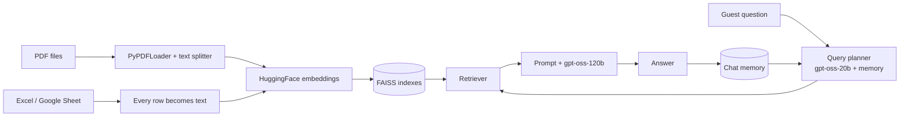

# Bremer Virtual Concierge

**A RAG-powered restaurant assistant with conversation memory, built on LangChain, FAISS, HuggingFace embeddings and Groq LLMs.**

      


---

## Overview

**Bremer Virtual Concierge** is a digital concierge for the Bremer restaurant (Mansoura, Egypt). It answers guest questions about the menu, prices, opening hours, branches, offers, policies and dietary needs, using **only the restaurant's own files** (PDFs and an Excel sheet), and it **remembers the conversation** so follow-up questions such as *"how much is it?"* or *"what about the cheaper one?"* work naturally.

The project is the mid-term assignment **"Building a Basic AI Knowledge Assistant with Memory"**. It covers the full chain: data integration, embeddings and vector search, a Retrieval-Augmented Generation (RAG) pipeline, chat memory, automated evaluation, and a Gradio demo interface.

## Features

- **Hybrid knowledge base**: unstructured data (PDFs) and structured data (Excel / Google Sheets) in one assistant.
- **Semantic search** with a multilingual HuggingFace embedding model and **FAISS** indexes, so guests can ask in Arabic or English while the files stay in English.
- **Query planner**: a fast LLM rewrites follow-up questions into standalone ones, picks which collections to search, and detects "whole list" questions (cheapest, most expensive, list all).
- **Two memory modes**: full **buffer memory** and **summary buffer memory** (recent turns kept word for word, older turns compressed into a summary).
- **Grounded answers**: the assistant answers only from retrieved context and never invents dishes, prices, hours or policies.
- **Allergy safety guardrail**: never claims a dish is safe for an allergy and automatically appends an allergy note and the restaurant phone number.
- **Replies in the guest's language** (Arabic / English).
- **Dish photo cards** in the chat for every item the assistant mentions, linked by `item_id`.
- **Built-in evaluation**: auto-generated test questions measuring accuracy, relevance and latency.
- **Resilient LLM setup**: if the large model hits its rate limit, the fast model answers instead.

## Architecture



**For every guest message the pipeline runs four steps:**

| Step | What happens |
|---|---|
| 1. **Plan** | The fast model rewrites the question to stand alone (using memory), chooses the collections to search and flags whole-list questions. |
| 2. **Retrieve** | Searches the chosen FAISS indexes. Whole-list questions read the full sheet table instead of top-k rows. |
| 3. **Generate** | The answer model responds using only the retrieved context, the memory and the question. |
| 4. **Finalize** | Adds an allergy note when needed and saves the turn in memory. |

## Tech Stack

| Layer | Technology |
|---|---|
| Orchestration | LangChain |
| Answer LLM | `openai/gpt-oss-120b` on Groq |
| Fast LLM (planner, summaries, grading) | `openai/gpt-oss-20b` on Groq |
| Embeddings | `sentence-transformers/paraphrase-multilingual-MiniLM-L12-v2` |
| Vector database | FAISS (CPU) |
| PDF / table parsing | PyPDF, pandas, openpyxl |
| Photo matching (optional) | CLIP (`clip-ViT-B-32`) + DuckDuckGo search |
| UI | Gradio `ChatInterface` |
| Environment | Google Colab |

## Project Structure

```
bremer-virtual-concierge/
├── assets/
│   └── chat-interface.png                      # Screenshot of the Gradio chat
├── data/
│   ├── Bremer_Restaurant_Data.xlsx             # Menu, Offers and Branches sheets
│   ├── Bremer_Menu_Descriptions.pdf            # Dish descriptions, prices, calories
│   ├── Bremer_Allergen_and_Dietary_Guide.pdf   # Allergen hints, vegetarian, spice levels
│   └── Bremer_Restaurant_Info_and_Policies.pdf # About, branches, hours, policies
├── notebooks/
│   └── Restaurant_AI_Assistant.ipynb           # Full project notebook
├── requirements.txt
├── .gitignore
└── README.md
```

## Knowledge Base

| Collection | Source | Type | Documents |
|---|---|---|---|
| `menu` | `Bremer_Restaurant_Data.xlsx` / Menu | Sheet | 111 rows |
| `offers` | `Bremer_Restaurant_Data.xlsx` / Offers | Sheet | 4 rows |
| `branches` | `Bremer_Restaurant_Data.xlsx` / Branches | Sheet | 2 rows |
| `documents` | 3 PDF files | PDF | 68 chunks |

- **Sheet rows** become short `column: value` sentences, and each row keeps its file, tab and row number as metadata.
- **PDF pages** are split into overlapping chunks (800 characters, 150 overlap) that keep their file name and page number.

## Getting Started

### 1. Get a Groq API key

Create a free key at [console.groq.com/keys](https://console.groq.com/keys).

### 2. Run on Google Colab (recommended)

1. Open `notebooks/Restaurant_AI_Assistant.ipynb` in [Google Colab](https://colab.research.google.com/) (**File → Upload notebook**, or open it directly from GitHub).
2. Add a Colab secret named **`GROQ_API_KEY`** (key icon in the left sidebar) and enable notebook access.
3. Run the cells from top to bottom.
4. In **Section 3**, upload the 4 files from the `data/` folder (3 PDFs and the Excel file).
5. Run **Section 12** and open the public `gradio.live` link that is printed.

### 3. Run locally

```bash
git clone https://github.com/<your-username>/bremer-virtual-concierge.git
cd bremer-virtual-concierge
pip install -r requirements.txt
export GROQ_API_KEY="your_key_here"      # Windows PowerShell: $env:GROQ_API_KEY="your_key_here"
jupyter notebook notebooks/Restaurant_AI_Assistant.ipynb
```

Outside Colab, copy the files from `data/` into a folder named `knowledge_files/` next to the notebook; the upload cell prints a reminder when it detects it is not running in Colab. The notebook reads the key from a Colab secret, then from the `GROQ_API_KEY` environment variable, and otherwise asks for it when you run the cell.

> **Never commit your API key.** Keep it in a Colab secret or an environment variable.

### Optional: use a Google Sheet instead of the Excel file

Paste a sheet link into `GOOGLE_SHEET_LINK` (Section 3). The sheet must be shared as **Anyone with the link: Viewer**. Each tab becomes its own collection.

## Configuration

All settings live in one cell of the notebook (Section 1):

| Setting | Default | Description |
|---|---|---|
| `ANSWER_MODEL` | `openai/gpt-oss-120b` | Model that writes the final answers |
| `FAST_MODEL` | `openai/gpt-oss-20b` | Planner, memory summaries and grading |
| `EMBEDDING_MODEL` | `paraphrase-multilingual-MiniLM-L12-v2` | Multilingual embeddings |
| `CHUNK_SIZE` / `CHUNK_OVERLAP` | `800` / `150` | PDF chunking |
| `TOP_K_SHEET` | `8` | Rows retrieved from a sheet |
| `TOP_K_PDF` | `5` | PDF chunks retrieved |
| `MAX_CONTEXT_CHARS` | `24000` | Context size limit sent to the LLM |
| `KEEP_RECENT_TURNS` | `4` | Turns kept verbatim in summary memory |
| `MEMORY_MODE` | `"buffer"` | `"buffer"` or `"summary_buffer"` |

## Conversation Memory

Memory is a small dictionary holding the chat history and a summary text.

- **Buffer memory** keeps the full conversation history.
- **Summary buffer memory** keeps the last few turns word for word and compresses older ones into an LLM-written summary, so long chats stay short.

The planner uses memory to resolve references like *"it"* or *"that one"*, and the answer prompt receives it so replies stay consistent. Each browser session in Gradio gets its own memory, and clearing the chat resets it.

## Example Questions

| Language | Question |
|---|---|
| English | What vegetarian dishes do you serve? |
| English | What are your opening hours? |
| English | Do you have any special offers? |
| English | What is the cheapest item on the menu? |
| English (follow-up) | *"Tell me about the Chicken BBQ Pizza"* → *"How much is it?"* |
| Arabic | ايه الأطباق النباتية عندكم؟ |
| Out of scope | Who won the World Cup? → politely declined |

## Testing and Evaluation

Section 10 generates test questions **from your own files**, so the evaluation always matches the data:

| Category | What it checks |
|---|---|
| Document facts / Sheet facts | Questions about random PDF chunks and sheet rows |
| Whole-list questions | Highest / lowest value of a numeric column, with the ground truth computed by pandas |
| Memory (follow-ups) | Two-question chats where the second question says "it" without the name |
| Out of scope | Unrelated questions that must be politely declined |

**Metrics**

- **Accuracy (0 or 1)**: exact name check for pandas questions, otherwise an LLM judge compares the answer with a reference.
- **Relevance (1 to 5)**: how directly and completely the answer addresses the question.

**Sample run** (15 generated questions):

| Metric | Result |
|---|---|
| Overall accuracy | 100% |
| Average relevance | 5.00 / 5 |
| Average latency | 8.3 s per answer |

> Test questions are sampled randomly from the data, so numbers vary slightly between runs.

## Safety and Data Notes

- The assistant **never states that a dish is safe for an allergy**. Allergen hints are derived from listed ingredients and are not an official declaration. Cross-contact is possible, and guests are directed to call **19113**.
- **Calories and some prices are estimates**, flagged in the `price_source` column and in the PDFs.
- **Offers, reservations, payment, cancellation and dining policies are project assumptions** written for this academic demo, not official Bremer policies. Opening hours, the phone number and the menu categories come from Bremer's official website.
- Menu prices come from a third-party listing (EGMenus, September 2026) and may differ by branch.
- Availability is a demo value, not a live stock feed.
- Permission to reuse Bremer's brand and menu data in a commercial product has **not** been confirmed. This dataset is for **academic and educational use only**.

## Roadmap

- [ ] Hosted deployment (Hugging Face Spaces) with a persistent FAISS index
- [ ] Live availability and ordering integration
- [ ] Voice input in Arabic
- [ ] Larger evaluation set and automated regression runs

## Acknowledgements

- [LangChain](https://www.langchain.com/), [FAISS](https://github.com/facebookresearch/faiss), [Sentence-Transformers](https://www.sbert.net/), [Groq](https://groq.com/) and [Gradio](https://www.gradio.app/)
- Menu information from [bremer-eg.com](https://bremer-eg.com) and EGMenus, used for educational purposes

## License

No license has been chosen yet. Add a `LICENSE` file (for example MIT for the code) before publishing if you want others to reuse it. Bremer's name, branding and menu data remain the property of their owners.
